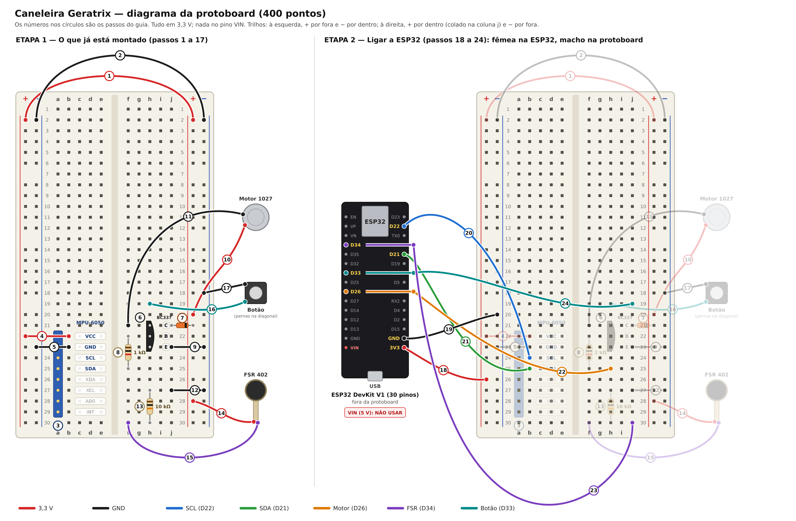

# P13 — Montagem na protoboard

**Situação em 27/11/2026.** Circuito montado por Felipe e Rafael de Oliveira Corrêa numa protoboard de 400 pontos. A ESP32 ficou **fora** da protoboard, ligada por jumpers macho-fêmea: encaixada, ela só ocupa as colunas b e j e deixa o lado direito sem furo livre para o GND e os GPIOs 26, 33 e 34. A posição de cada peça está abaixo e no diagrama `docs/diagrama-protoboard.png`, com os mesmos números de passo.

A protoboard usada não é a de 170 pontos da lista de materiais (`docs/inventario-materiais.md`, item 10): é uma de 400 pontos, com linhas 1 a 30, colunas a–e e f–j e trilhos de alimentação dos dois lados. Mesmo com ela, a ESP32 não cabe junto com as outras peças, e fica fora, ligada por jumpers.

## Esquema elétrico (ligações)

Mesmo mapa de pinos do guia (seção 6.2) e do `firmware/caneleira/caneleira.ino`. Tudo em 3,3 V: **nada vai ao pino VIN (5 V)**.

| Peça | Pino da peça | Liga em | GPIO da ESP32 |
|---|---|---|---|
| MPU-6050 (GY-521) | VCC | 3V3 | — |
| | GND | GND | — |
| | SCL | — | 22 |
| | SDA | — | 21 |
| | XDA, XCL, AD0, INT | sem ligação (AD0 solto = endereço 0x68) | — |
| FSR 402 | uma perna | 3V3 | — |
| | outra perna | resistor de 10 kΩ para o GND | 34 (ponto entre o FSR e o 10 kΩ) |
| Motor 1027, 3 V | fio vermelho | 3V3 | — |
| | fio preto | coletor do BC337 | — |
| Diodo 1N4148 | anodo (sem listra) | coletor do BC337 (fio preto do motor) | — |
| | catodo (listra) | 3V3 (fio vermelho do motor) | — |
| BC337 | base | resistor de 1 kΩ | 26 (pelo 1 kΩ) |
| | emissor | GND | — |
| Botão 12 mm | uma perna | — | 33 (pull-up interno) |
| | perna oposta, na diagonal | GND | — |

O motor é acionado pelo lado do GND (*low-side*): o GPIO 26 liga o BC337 pela base, e o diodo em antiparalelo com o motor absorve o pico de tensão quando ele desliga. O FSR forma um divisor com o 10 kΩ: solto, o GPIO 34 fica perto de 0 V; com a tira apertada, a tensão sobe e passa dos limiares do firmware (`USO_LIGA_MV` e `USO_DESLIGA_MV`, em `firmware/caneleira/ajustes.h`). O GPIO 35 (bateria) fica sem ligação, porque a alimentação é pelo power bank (D15).

**Conta do motor.** Com a base em 3,3 V pelo 1 kΩ, a corrente de base é de cerca de (3,3 − 0,7) / 1000 ≈ 2,6 mA. Para os até 60 mA do motor, o BC337 precisa de ganho de só ~23, bem abaixo do mínimo dele, então satura com folga. A corrente sai do 3V3 da placa, cujo regulador fornece algumas centenas de mA, suficiente para a ESP32 com Wi-Fi e o motor.

## Posição de cada peça na protoboard

Lembrete: cada linha de 5 furos (a–e ou f–j) é ligada por dentro. Trilhos: do lado esquerdo, + na fileira de fora e − na de dentro; do lado direito, o contrário (+ por dentro, colado na coluna j, e − por fora). Nos trilhos, qualquer furo da mesma fileira serve.

| # | Ligação | De | Para |
|---:|---|---|---|
| 1 | Ponte do + | trilho + esquerdo | trilho + direito (altura da linha 1) |
| 2 | Ponte do − | trilho − esquerdo | trilho − direito (altura da linha 1) |
| 3 | MPU-6050 em pé, na coluna a | VCC a22, GND a23, SCL a24, SDA a25 | XDA a26, XCL a27, AD0 a28, INT a29, sem nada |
| 4 | VCC da MPU | b22 | trilho + esquerdo |
| 5 | GND da MPU | b23 | trilho − esquerdo |
| 6 | BC337, face chata para o lado a–e | C h21, B h22, E h23 | — |
| 7 | Diodo 1N4148 | j21 (sem listra) | trilho + direito (listra) |
| 8 | Resistor de 1 kΩ (marrom, preto, vermelho) | f22 | f25 |
| 9 | Emissor no GND | j23 | trilho − direito |
| 10 | Motor, fio vermelho | trilho + direito | — |
| 11 | Motor, fio preto | f21 | — |
| 12 | GND do divisor do FSR | j27 | trilho − direito |
| 13 | Resistor de 10 kΩ (marrom, preto, laranja) | h27 | h30 |
| 14 | FSR, primeira perna (jumper macho-fêmea) | trilho + direito | — |
| 15 | FSR, segunda perna (jumper macho-fêmea) | f30 | — |
| 16 | Botão, primeira perna (macho-fêmea) | h19 | — |
| 17 | Botão, perna oposta na diagonal (macho-fêmea) | trilho − direito | — |
| 18 | 3V3 da ESP32 (**não o VIN**) | pino 3V3 | trilho + esquerdo |
| 19 | GND da ESP32 | pino GND | trilho − esquerdo |
| 20 | SCL | pino D22 | b24 |
| 21 | SDA | pino D21 | b25 |
| 22 | Sinal do motor, pelo 1 kΩ | pino D26 | h25 |
| 23 | Sinal do FSR | pino D34 | j30 |
| 24 | Botão | pino D33 | j19 |

Nos passos 18 a 24, a ponta fêmea vai no pino da ESP32 e a macho, na protoboard. O VIN (5 V) fica na mesma ponta da placa que o 3V3, do outro lado: nada vai nele.

## Antes de ligar a ESP32

1. Confira a montagem contra a tabela acima, de preferência por foto de cima.
2. Sem nada energizado, use o multímetro em continuidade: o trilho + (3,3 V) **não** pode ter continuidade com o trilho −. Se tiver, há curto; não ligue a placa.
3. Confira que nada está ligado no pino VIN da ESP32.
4. Grave primeiro o teste de bancada (`firmware/testes/teste_bancada_esp32/`), não o firmware completo. Ele não precisa de biblioteca e diz, peça por peça, o que está funcionando:
   - na partida, `MPU-6050 ok (WHO_AM_I = 0x68)` e três pulsos no motor;
   - a cada 250 ms, o ângulo mudando ao inclinar a MPU, o FSR perto de 0 mV solto e acima de 600 mV (`PRESA`) apertado;
   - ao apertar o botão, `botao` e um pulso de 300 ms no motor.
5. Anote no monitor serial a tensão do FSR com a tira solta e presa na perna: são os valores para ajustar `USO_LIGA_MV` e `USO_DESLIGA_MV` (P8).
6. Só então grave o `caneleira.ino`. Os eixos da MPU, os limiares do FSR e o motor se ajustam em `firmware/caneleira/ajustes.h`.

## Da protoboard para a caneleira

Na caixa, a ESP32 fica presa com fita dupla face ao lado da protoboard, ligada pelos jumpers dos passos 18 a 24, presos com abraçadeira ou fita. O FSR (na tira, entre a tira e a perna), o motor (encostado na pele) e o botão (do lado de fora da caixa) ficam ligados por jumpers macho-fêmea. A MPU-6050 precisa ficar firme: se ela balançar na protoboard, o ângulo sai errado. Nesse caso, prenda-a com fita dupla face ou passe-a para o fundo da caixa, ligada por jumpers.
